# Assignment #6. jQuery (Selectors, Effects, Animations)

**Name:** Madina Sabyrgali
**Group:** IT-2503

**GitHub repository:** https://github.com/qzxcvwyil/your-repo
**GitHub Pages:** https://qzxcvwyil.github.io/your-repo/

This is my portfolio page for Assignment 6. It is one page with a section for each task, so you can scroll down and try everything in order. Below I go through the tasks one by one: first the task itself, then what I did, then a screenshot.

---

## Part 1. Getting Started with jQuery

### Task 0. Setup

- Include jQuery from a CDN.
- Write a `$(document).ready(function() { ... })` function.
- Test by printing *"jQuery is ready!"* in the console.

I added jQuery 3.7.1 from `code.jquery.com` at the bottom of `index.html`, right before my own `script.js`, so that jQuery is already loaded when my code runs. Everything in `script.js` lives inside `$(document).ready()`, and the very first line prints `jQuery is ready!` to the console. That was my quick check that everything is connected properly.

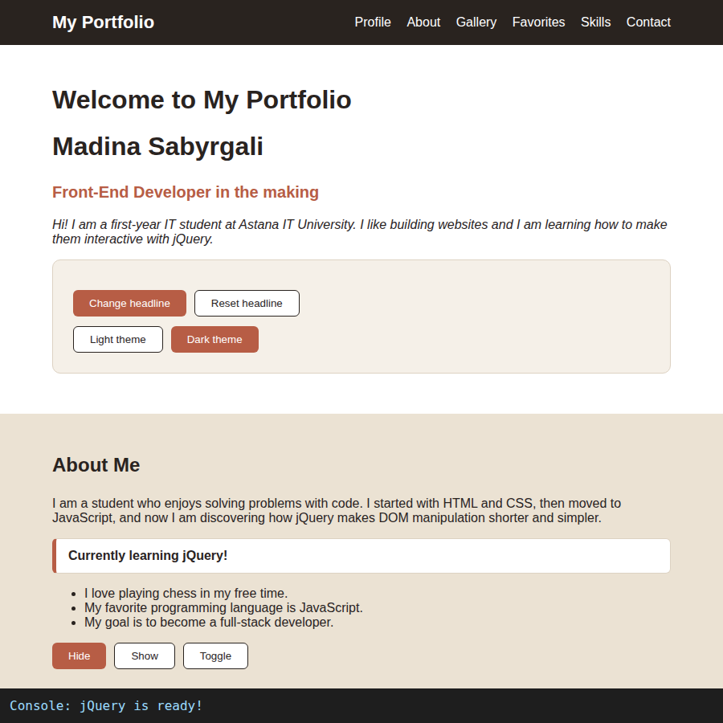

### Task 1. Selectors & CSS

- Display your name, a personal headline, and a short introduction.
- Include a profile section with a title such as "Welcome to My Portfolio."
- Use tag, ID, and class selectors to select different HTML elements.
- Dynamically update your greeting or headline using `.text()` or `.html()`.
- Use `.css()` to change the styling of selected elements.
- Add buttons to switch between light and dark themes.

At the top of the page there is a profile section with the title "Welcome to My Portfolio", my name, a headline and a short intro about me.

For selectors I used one of each kind: a tag selector `$("h1")`, an ID selector `$("#name")` and a class selector `$(".intro")`. With `.css()` I changed the title color, made my name bigger and made the intro italic.

The "Change headline" button changes the headline with `.text()` and the title with `.html()`, because there I wanted to add an `<em>` tag. "Reset headline" puts everything back. The "Light theme" and "Dark theme" buttons recolor the page with `.css()`: the background, the text, the boxes and the links.

Before:

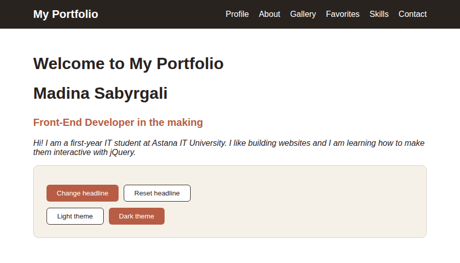

After clicking "Change headline":

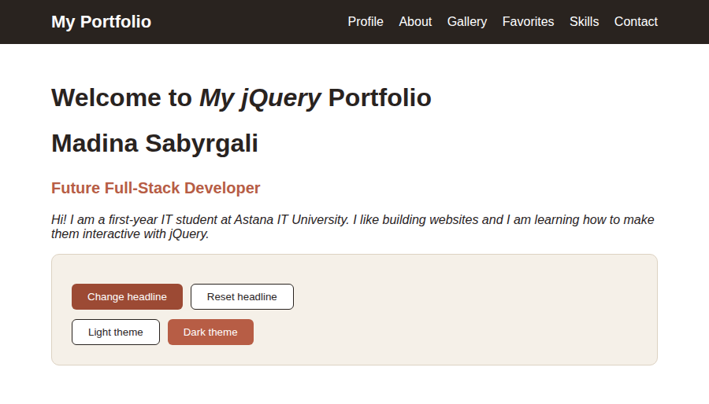

Dark theme:

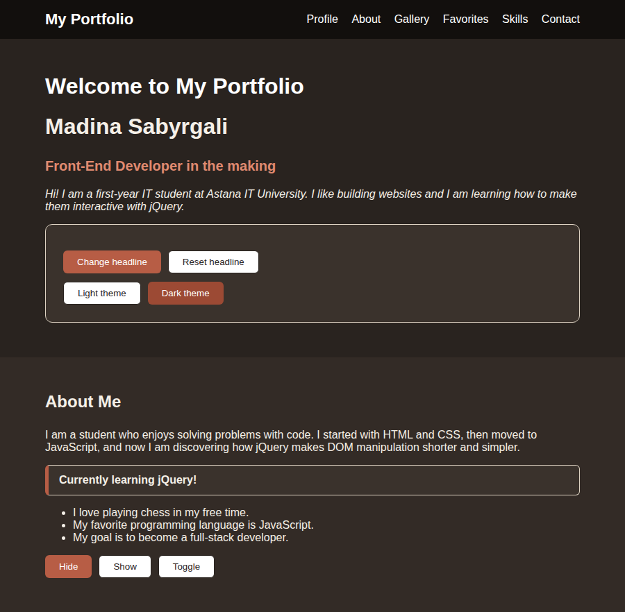

---

## Part 2. jQuery Effects

### Task 2. Visibility Methods

- Create an "About Me" section.
- Add a short biography and a current status message, such as "Currently learning jQuery!"
- Include a few fun facts about yourself, your interests, or your goals.
- Add three buttons: **Hide, Show, and Toggle.**
- Use the buttons to control the visibility of your status message or fun facts.

In the "About Me" section I wrote a short bio, a status message ("Currently learning jQuery!") and three fun facts (chess, my favorite language and my goal to become a full-stack developer).

The three buttons work on the status message and the fun facts at the same time: Hide uses `.hide()`, Show uses `.show()` and Toggle uses `.toggle()`.

After "Hide":

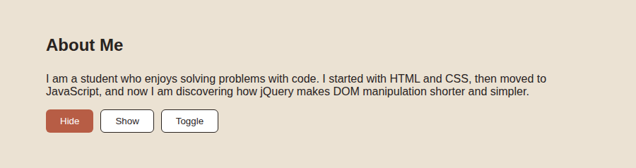

After "Show":

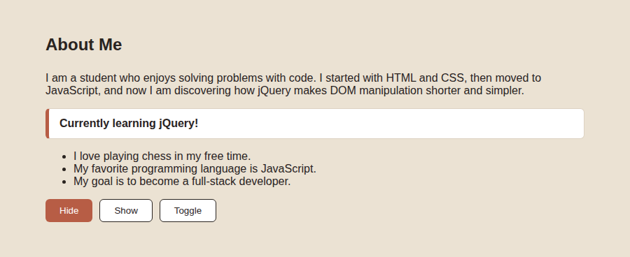

### Task 3. Fade Methods

- Display at least two images.
- Use `.fadeIn()`, `.fadeOut()`, `.fadeToggle()` effects to control the visibility of gallery images.

The gallery has three pictures, one more than the minimum. The buttons call `.fadeIn(800)`, `.fadeOut(800)` and `.fadeToggle(800)` on all of them, so the images fade in and out smoothly in a bit less than a second.

After "Fade Out":

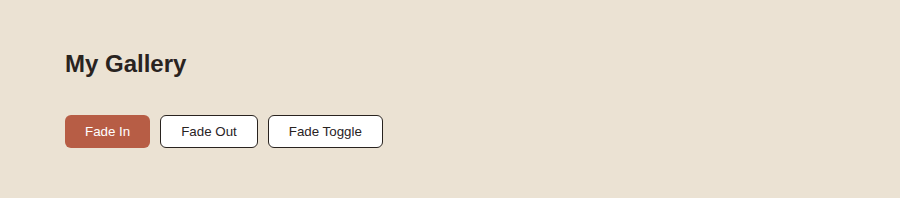

After "Fade In":

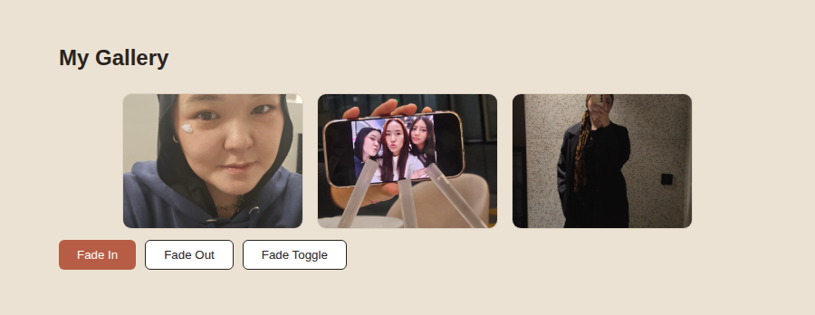

### Task 4. Slide Methods

- Create at least three clickable headings.
- Place related information inside a collapsible panel beneath each heading.
- Use `.slideUp()`, `.slideDown()`, `.slideToggle()` to make the interaction smooth.

I made three clickable headings: Favorite Music, Favorite Movie and Favorite Subject. Under each one there is a hidden panel with my answer. When you click a heading, `$(this).next(".panel").slideToggle()` opens or closes only the panel right below it.

I also added two extra buttons so that all three slide methods are used: "Open all" calls `.slideDown()` on every panel and "Close all" calls `.slideUp()`.

Music and Subject panels opened:

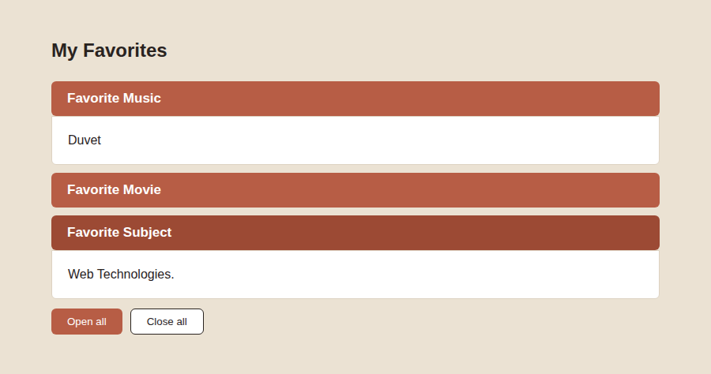

After "Close all":

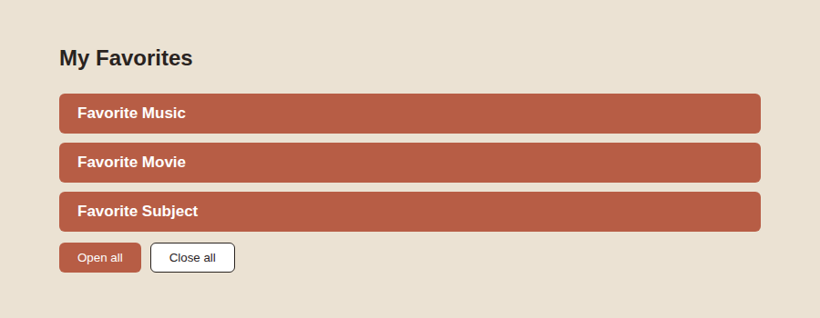

---

## Part 3. DOM Manipulation with jQuery

### Task 5. Add & Remove Elements

- Display an initial list containing at least four technical skills.
- Add a text input where visitors can enter a new skill.
- Create three buttons: "Add Skill," "Prepend Skill," and "Remove Skill."
- Use `.append()`, `.prepend()`, `.remove()`.
- Prevent empty skills from being added.

The list starts with four skills: HTML, CSS, JavaScript and Python. Under it there is an input and three buttons:

- **Add Skill** puts the new skill at the end of the list with `.append()`.
- **Prepend Skill** puts it at the very beginning with `.prepend()`.
- **Remove Skill** deletes the last item with `.remove()`.

To stop empty skills, I read the input with `.val().trim()` and check it first. If it is empty, nothing is added and a red message appears under the buttons. The `.trim()` is there so that a skill made of only spaces does not get through either. After a successful add, the input is cleared. Remove also shows a message if the list is already empty.

Empty input:

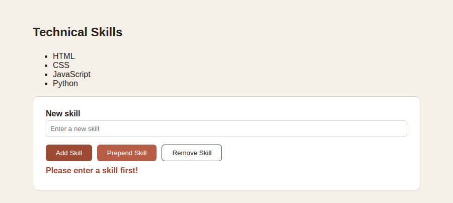

After adding "React" (append) and "Git" (prepend):

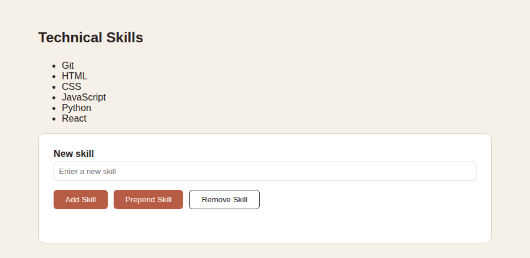

After "Remove Skill":

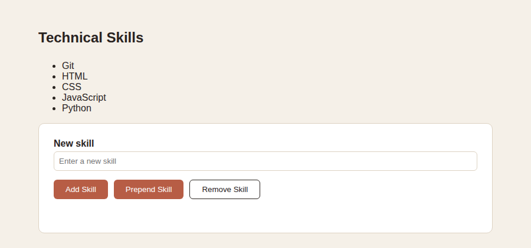

### Task 6. Modifying Attributes

- Add a social media link, such as GitHub, LinkedIn, or a personal website.
- Create a button that dynamically changes the link's destination using `.attr()`.

In the contact section there is a link to my GitHub. The button below it switches the link to LinkedIn with `.attr("href", ...)` and changes the link text and the button text too. Clicking it again switches everything back to GitHub. I also show the current address under the link, so you can see that the `href` really changed.

Before:

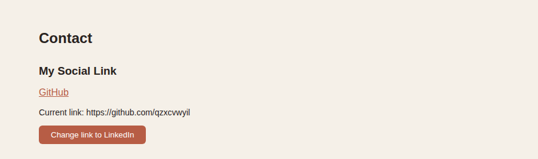

After the click:

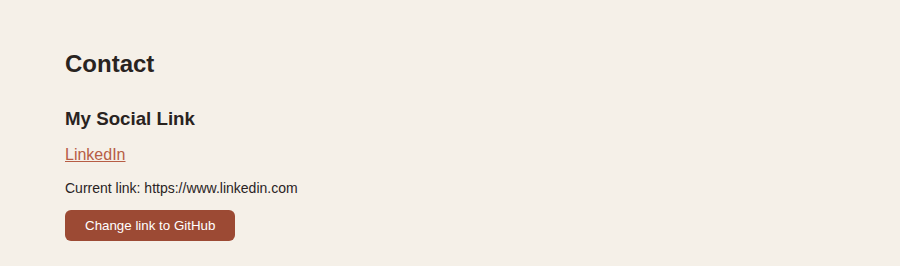

### Task 7. Form Interaction

- Create a form with inputs for Name and Email.
- When the user types, display their input live below the form using `.val()` and `.text()`.

The form has two inputs, Name and Email. I used the `keyup` event, so after every key you press, the code takes the current value of the field with `.val()` and writes it into the "Name:" or "Email:" line below the form with `.text()`.

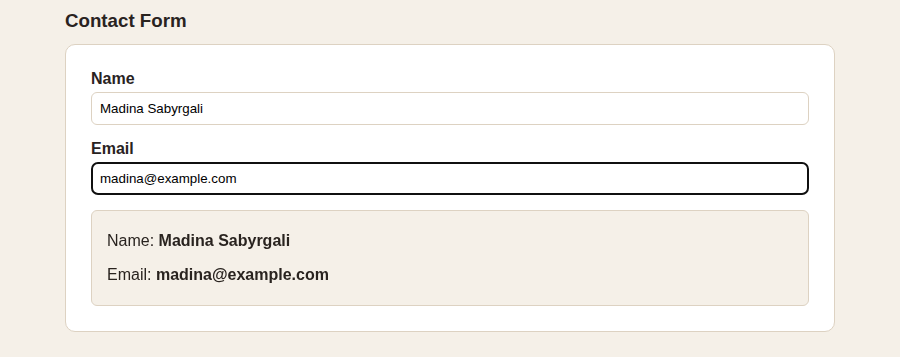

---

## Part 4. Animations

### Task 8. Basic Animation

- Extend Task 5 by creating a visual representation of at least three technical skills using skill bars.
- Add an "Animate My Skills" button.
- Initially, the skill bars should have zero width.
- When the button is clicked, use `.animate()` to increase the width of each skill bar.
- Use different target widths to represent different skill levels.
- When the button is clicked again, animate the skill bars back to zero width.

Right under the skills list from Task 5 there are four skill bars: HTML 90%, CSS 75%, JavaScript 60% and Python 45%. In the CSS every bar starts with `width: 0`, so at first you see only empty gray tracks.

On the first click of "Animate My Skills", each bar gets its own `.animate()` call with its own target width, so they stop at different lengths. The animation takes 1.2 seconds. On the second click, all bars (`$(".bar")`) shrink back to `0%`, and the button text changes between "Animate My Skills" and "Reset Skills". To know which click it is, I keep a variable `barsAreFull` that remembers the current state.

Initial state (zero width):

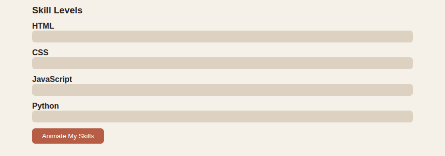

During the animation:

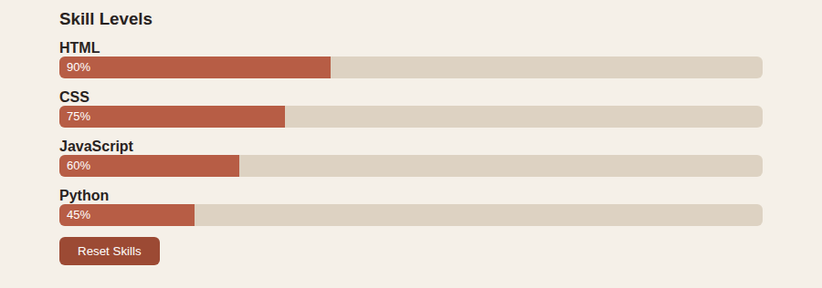

Finished:

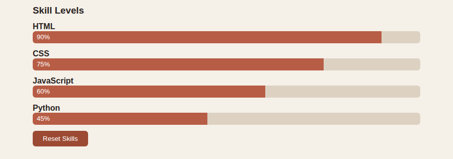

After the second click (back to zero):

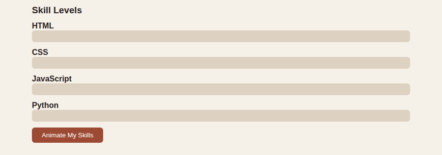

---

## How I worked on it

I started by reading the assignment and deciding to put everything on one page, with one section per task. Then I wrote the HTML for all sections first, added the styles, and only after that started with jQuery, task by task. After each task I opened the page and clicked every button, with the console open, so I could catch mistakes early instead of finding them all at the end.

Most things went smoothly, but two parts took me longer. The skill bars were the first: the button has to do two different things depending on the current state, and I needed a variable to remember that. The second was the dark theme. Changing the color of the body was easy, but then the boxes, panels, headline and links stayed light or looked wrong, so I had to go through the elements and set their colors one by one with `.css()`.

In the end I checked that the page works without errors in the console, took the screenshots, uploaded the project to GitHub and turned on GitHub Pages. While doing this assignment I really felt why people use jQuery: things like hiding an element or fading an image are one short line instead of a long block of plain JavaScript.

## Project structure

```
index.html
style.css
script.js
images/
screenshots/
README.md
```
